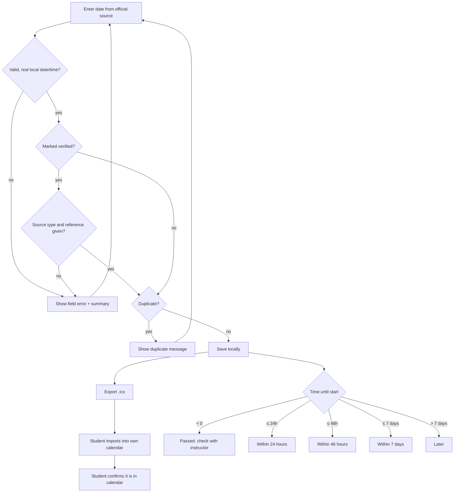

# INFS1101 CLO mapping — Assessment Guard

**Source:** _CCIT INFS1101 Fall 2026_, UDST Course Master Syllabus (4 pages), effective Fall 2026. Used here for: the four CLOs (page 1), the topic list — sequence/selection/repetition, algorithms, string/list operations, decomposition into methods (page 2), and the assessment weights (final 35%, labs 10%, midterm 20%, quizzes 15%, tests 20%; pass 60%). The syllabus contains **no exam dates, retake rules, instructor names or section rules**, and this tool invents none.

This is a learning project showing the CLOs applied to a real problem. It is **not** a substitute for any course assessment and claims no credit.

## Use case traced through all four CLOs

> _A student copies a quiz date from a D2L announcement, saves it, exports it to their calendar, and later sees it flagged "Within 48 hours"._

### CLO1 — Discuss programming as a problem-solving process

| Step               | Applied here                                                                                                                   |
| ------------------ | ------------------------------------------------------------------------------------------------------------------------------ |
| Define the problem | Dates are lost between announcement and calendar; nothing tells the student a date is unchecked or never reached the calendar. |
| Inputs             | course, type, name, local date/time, verified?, source type, source reference, location                                        |
| Outputs            | sorted list with risk states, `.ics` file, attention flags, grade-scenario text                                                |
| Constraints        | no D2L access, no server, no invented dates, honest about what is _not_ done (export ≠ import)                                 |
| Test               | 24 unit tests + 21 real-browser checks (see README)                                                                            |

### CLO2 — Use control structures (sequence, selection, repetition)

- **Selection** — risk state, `timeState()` in [`src/core.js`](../src/core.js) line 172:
  ```js
  if (diff < 0) return "overdue";
  if (diff <= 24 * HOUR) return "within24h";
  if (diff <= 48 * HOUR) return "within48h";
  if (diff <= 7 * 24 * HOUR) return "within7d";
  return "later";
  ```
  Boundaries tested with a fixed clock (`time state boundaries` test).
- **Selection** — `gradeAnalysis()` line 450 chooses `possible` / `impossible` / `already-secured` / `met` / `not-met`.
- **Repetition** — `for…of` over weights in `gradeAnalysis()`, over records in `parseStore()` line 254, over events and alarms in `buildIcs()` line 364, over characters in `foldLine()` line 327; `render()` in [`src/app.js`](../src/app.js) line 281 loops over the filtered list.
- **Sequence** — `onSubmit()` (app.js line 194): read → validate → duplicate check → save → render → announce.

### CLO3 — Design algorithms with flowcharts / pseudocode

Pseudocode for "save an assessment":

```
READ form fields
IF date missing OR malformed OR not a real local time THEN show error; STOP
IF status = verified AND (source type empty OR source reference empty) THEN show error; STOP
IF same course+type+name+instant already saved THEN show "duplicate"; STOP
STORE record with checkedAt = now
FOR EACH saved record (sorted by start time)
    state ← timeState(start, now)
    flags ← []
    IF not verified THEN add "not verified"
    IF state ≠ overdue AND not confirmed in calendar THEN add "not confirmed in calendar"
    DISPLAY name, date, state in words, flags
END FOR
```

Flowchart:



### CLO4 — Develop basic programs

Decomposition into small, single-purpose functions (topic: methods), each unit-tested:

| Function (core.js)             | Line      | Topic                                |
| ------------------------------ | --------- | ------------------------------------ |
| `parseLocalDateTime`           | 41        | string parsing, selection            |
| `validateAssessmentInput`      | 99        | selection, string operations         |
| `isDuplicate`                  | 150       | list search                          |
| `timeState` / `attentionFlags` | 172 / 183 | selection                            |
| `filterAssessments`            | 203       | list sort + filter                   |
| `parseStore`                   | 254       | repetition, defensive input handling |
| `foldLine` / `buildIcs`        | 327 / 364 | string operations, repetition        |
| `gradeAnalysis`                | 450       | arithmetic, selection, repetition    |

Tests: [`test/core.test.js`](../test/core.test.js) (unit) and [`test/smoke.mjs`](../test/smoke.mjs) (browser).

## Tested outcomes for this use case

| Claim                                                         | Evidence                             |
| ------------------------------------------------------------- | ------------------------------------ |
| Saved date appears in chronological order and survives reload | smoke check 2b                       |
| Unverified date can't be passed off as verified               | unit tests + smoke check 3b          |
| 48 h / 24 h / 7 d boundaries are exact                        | unit test "time state boundaries"    |
| Exported `DTSTART` equals the entered local time              | smoke check 5b (Asia/Qatar)          |
| Midterm 0 + 75% on the remaining 80% ⇒ 60%                    | unit test + smoke check 7            |
| Import into a real calendar app                               | **untested** — manual step in README |
